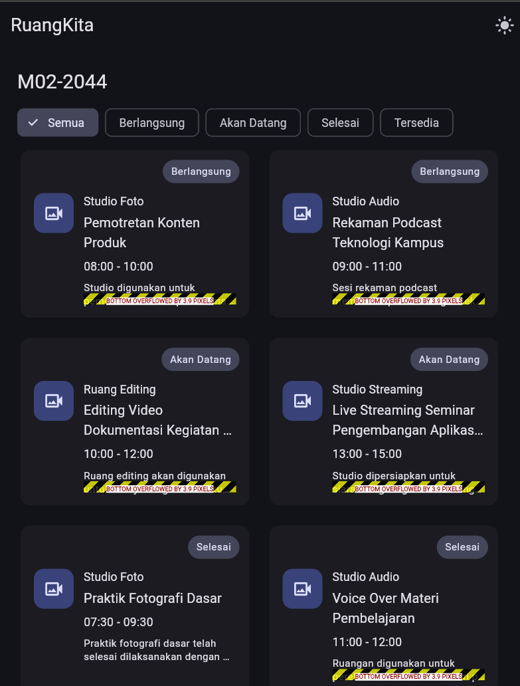
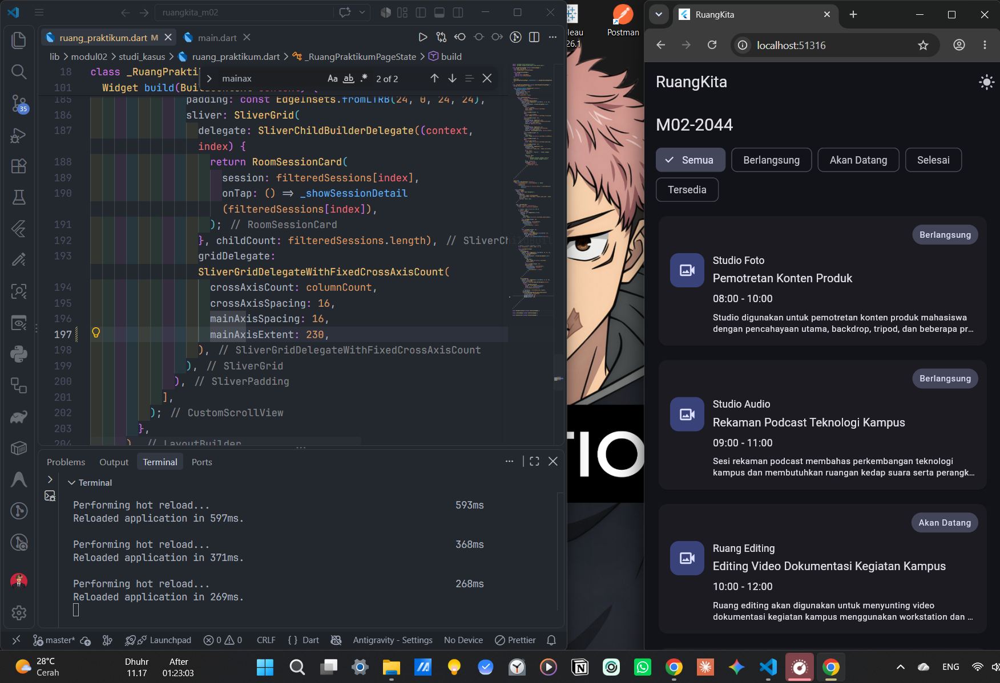
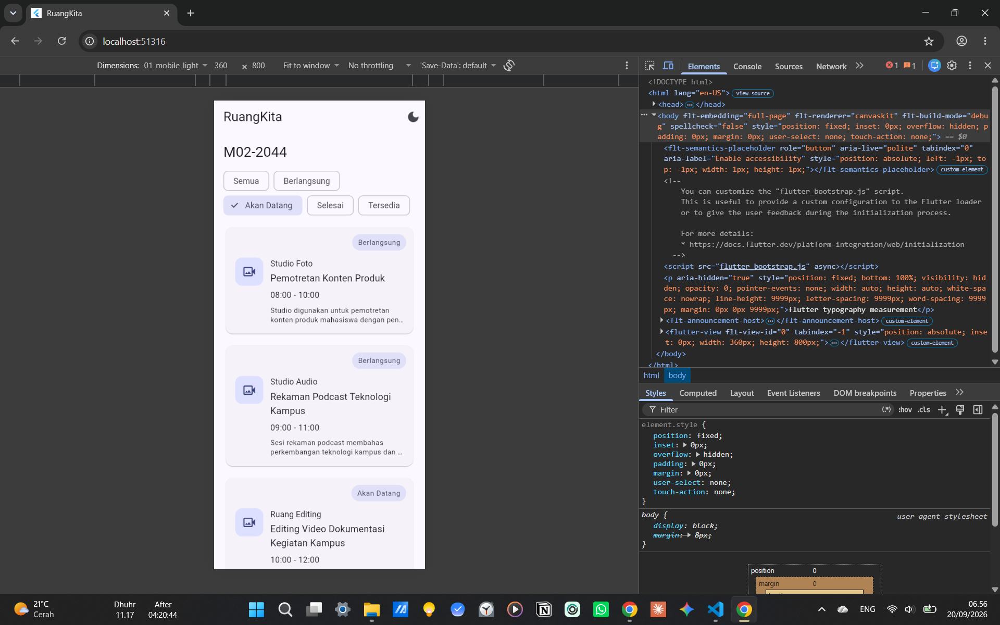
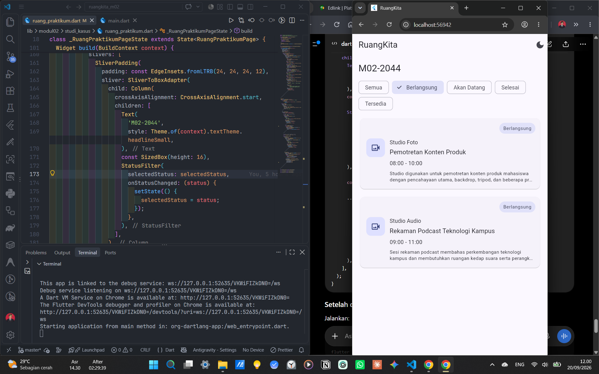

# Debug Notes

## Bug 1: RenderFlex Overflow pada Layout Medium dan Expanded

### Gejala

Saat aplikasi dijalankan pada layout medium dan expanded, beberapa card mengalami `RenderFlex overflow`.

### Dugaan Akar Masalah

Card menggunakan `childAspectRatio` pada `SliverGrid`. Ketika jumlah kolom bertambah, lebar setiap card menjadi lebih kecil sehingga tinggi card yang dihasilkan grid juga tidak mencukupi untuk seluruh isi card.

### Screenshot Before

### Perubahan Kode

Properti `childAspectRatio` pada `SliverGrid` diganti menjadi `mainAxisExtent` agar tinggi card memiliki ukuran yang cukup dan konsisten.

### Screenshot After

### Hasil

Card dapat ditampilkan pada layout medium dan expanded tanpa `RenderFlex overflow`.

---

## Bug 2: Filter Tidak Berubah pada Layout Compact

### Gejala

Pada viewport compact/mobile, `ChoiceChip` dapat ditekan tetapi daftar card tidak berubah. Pada layout medium dan expanded, filter bekerja dengan normal.

### Dugaan Akar Masalah

Bagian layout compact masih menggunakan `roomSessions` secara langsung sehingga hasil `filteredSessions` tidak digunakan ketika daftar card dibuat.

### Screenshot Before

### Perubahan Kode

Daftar card pada layout compact diubah agar menggunakan `filteredSessions`, sehingga hasil filter digunakan sebagai sumber data yang ditampilkan.

### Screenshot After

### Hasil

Filter pada layout compact sekarang memperbarui daftar card secara langsung sesuai status yang dipilih melalui `setState()`.
