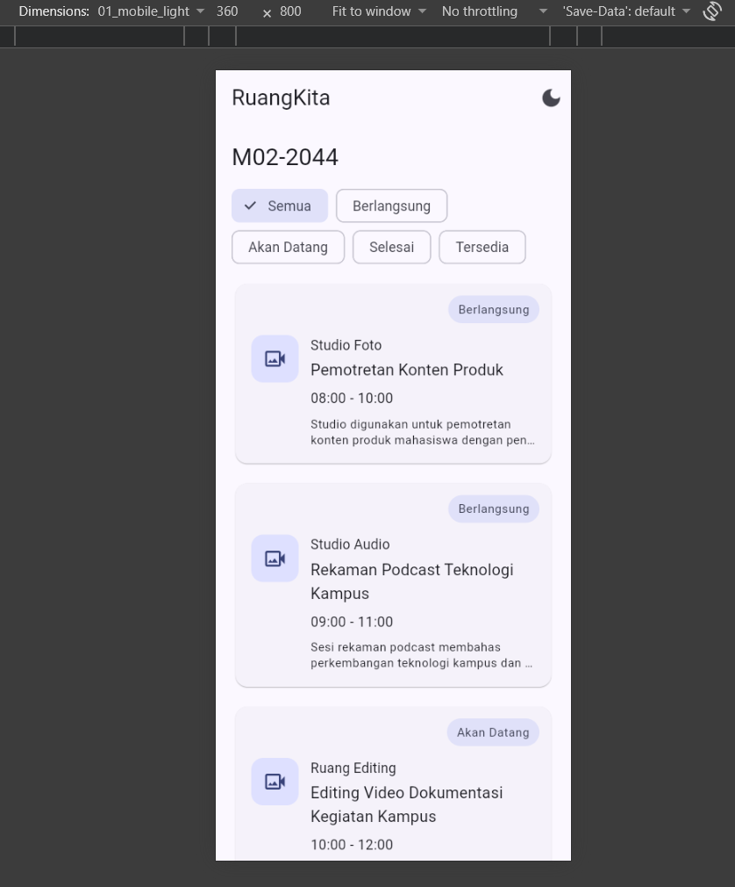
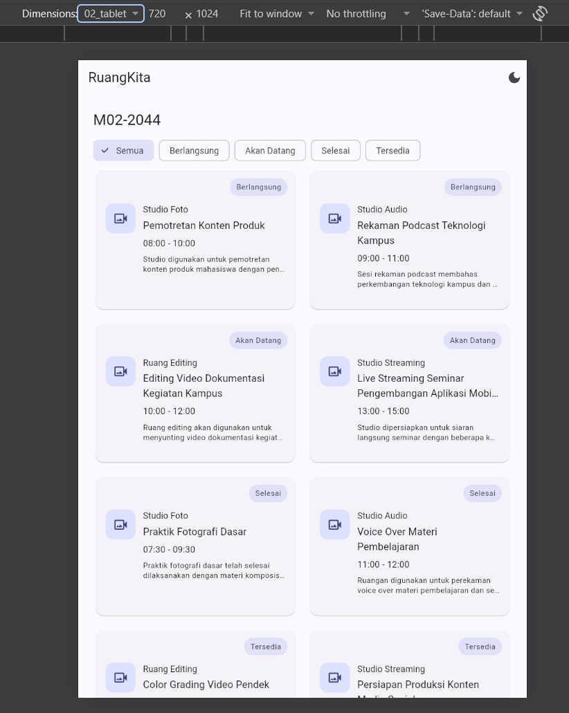
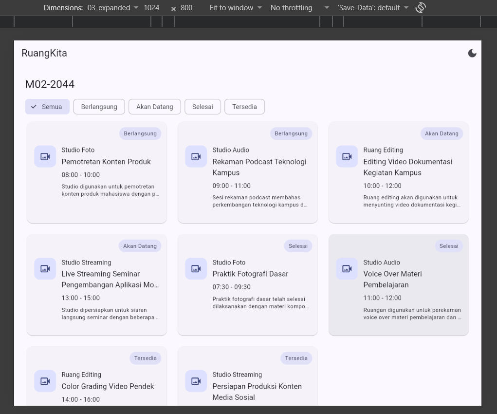
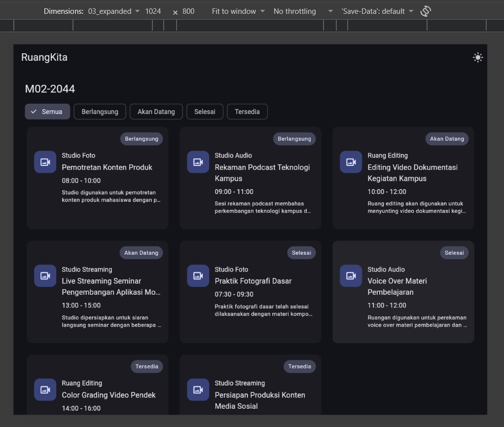

# RuangKita: Modul 02

## Identitas Mahasiswa

| Data           | Keterangan                     |
| -------------- | ------------------------------ |
| Nama           | Adam Marchelino                |
| NIM            | 362558302044                   |
| Kode Identitas | M02-2044                       |
| Varian         | Studio & Multimedia            |
| Mata Kuliah    | Pemrograman Perangkat Bergerak |

## Deskripsi

RuangKita adalah halaman aplikasi Flutter yang menampilkan status penggunaan ruang dan fasilitas Studio & Multimedia pada hari ini.

Data yang ditampilkan mencakup nama ruang, kegiatan, waktu, status, dan deskripsi. Aplikasi menyediakan filter status, tampilan responsif untuk beberapa ukuran viewport, Light/Dark Mode, serta detail sesi melalui BottomSheet.

## Struktur Widget dan Arsitektur

Halaman utama menggunakan `StatefulWidget` karena aplikasi memiliki state lokal yang dapat berubah, yaitu pilihan filter status dan mode tema.

Struktur utama aplikasi:

```text
MaterialApp
└── RuangPraktikumPage
    └── Scaffold
        ├── AppBar
        │   ├── Text
        │   └── IconButton
        └── Body
            └── LayoutBuilder
                ├── Compact
                │   └── ListView
                │       ├── M02-2044
                │       ├── StatusFilter
                │       └── RoomSessionCard
                └── Medium / Expanded
                    └── CustomScrollView
                        └── SliverGrid
                            └── RoomSessionCard
```

Pada `RoomSessionCard`, digunakan `Card`, `InkWell`, `Stack`, `Positioned`, `Row`, `Column`, dan `Expanded`.

`Stack` dan `Positioned` digunakan untuk menempatkan badge status sebagai overlay pada card. `Expanded` digunakan agar bagian konten teks mengambil sisa ruang horizontal yang tersedia di dalam `Row`.

## Responsive Breakpoint

| Lebar      | Layout            | Widget yang digunakan          | Alasan                                                              |
| ---------- | ----------------- | ------------------------------ | ------------------------------------------------------------------- |
| < 600 dp   | Compact, 1 kolom  | `LayoutBuilder` + `ListView`   | Ruang horizontal terbatas sehingga card ditampilkan secara vertikal |
| 600–839 dp | Medium, 2 kolom   | `LayoutBuilder` + `SliverGrid` | Ruang cukup untuk dua card per baris                                |
| >= 840 dp  | Expanded, 3 kolom | `LayoutBuilder` + `SliverGrid` | Memanfaatkan ruang horizontal yang lebih besar                      |

Breakpoint ditentukan melalui `constraints.maxWidth` dari `LayoutBuilder`.

## Fitur

* 8 data sesi lokal melalui model `RoomSession`
* 4 fasilitas Studio & Multimedia
* Status Berlangsung, Akan Datang, Selesai, dan Tersedia
* Filter menggunakan `Wrap` dan `ChoiceChip`
* Light/Dark Mode dengan Material 3
* Responsive layout untuk compact, medium, dan expanded
* Badge status menggunakan `Stack` dan `Positioned`
* Detail sesi menggunakan `showModalBottomSheet`
* Kontrol lokal favorit pada BottomSheet
* Pengamanan teks panjang menggunakan `maxLines` dan `TextOverflow.ellipsis`

## Screenshot Running

### 1. Mobile Light Mode



### 2. Tablet



### 3. Expanded



### 4. Dark Mode



## Git

Repository dikembangkan secara bertahap menggunakan beberapa commit untuk menunjukkan proses pengerjaan dan perbaikan.

Commit final:
725ad89cd51264276861b8fb0e193cdf13a9461e

## Refleksi Teknis

### 1. Mengapa Expanded membantu Text di dalam Row?

`Row` memberikan ruang horizontal kepada child berdasarkan constraints yang diterima. `Expanded` membuat widget teks mengambil sisa ruang yang tersedia sehingga teks tidak memaksa `Row` menjadi lebih lebar. Dengan tambahan `maxLines` dan `TextOverflow.ellipsis`, teks panjang dapat ditampilkan dengan aman tanpa menyebabkan overflow.

### 2. Mengapa LayoutBuilder lebih tepat untuk layout lokal dibanding hanya MediaQuery?

`LayoutBuilder` menggunakan constraints yang diberikan parent kepada widget pada lokasi tersebut. Hal ini membuat keputusan layout berdasarkan ruang yang benar-benar tersedia untuk bagian UI tersebut. Karena tugas menggunakan breakpoint compact, medium, dan expanded, `LayoutBuilder` digunakan untuk membaca `constraints.maxWidth` dan menentukan layout yang sesuai.

### 3. Apa yang berubah pada widget tree ketika setState() dipanggil?

Ketika `setState()` dipanggil, Flutter menjadwalkan proses rebuild pada `State` yang bersangkutan. Method `build()` dijalankan kembali sehingga bagian UI yang bergantung pada state mendapatkan nilai terbaru.

Pada aplikasi ini, ketika `selectedStatus` berubah, `filteredSessions` dihitung ulang dan daftar card yang ditampilkan berubah. Ketika mode tema berubah, `MaterialApp` menggunakan theme atau darkTheme sesuai nilai `themeMode`.

## Debugging

Dua masalah nyata yang ditemukan selama pengujian didokumentasikan pada:

`DEBUG_NOTES.md`

Evidence before/after disimpan di folder:

`evidence/`

## Penggunaan AI

Penggunaan AI dijelaskan secara transparan pada:

`AI_USAGE.md`
